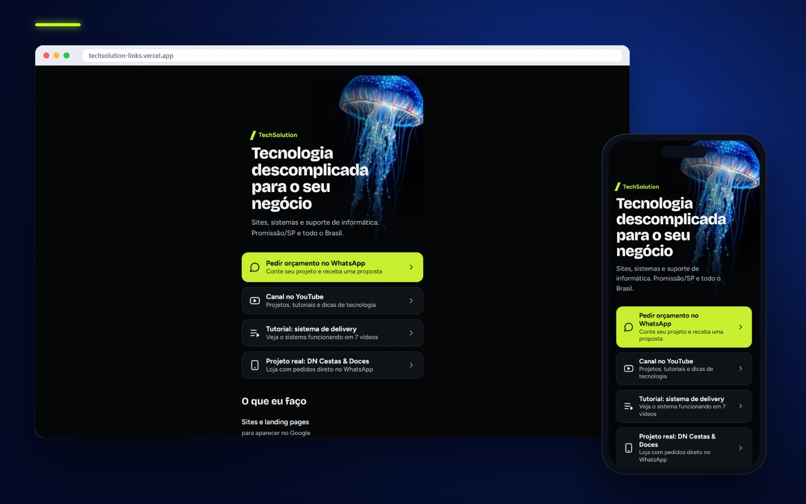

  

  
  

# Página de links da TechSolution

A página que fica na bio do Instagram da TechSolution. Em vez de usar um serviço pronto como o Linktree, ela foi **feita do zero**, com a identidade da marca.

## Por que fazer do zero

- **Identidade própria:** fundo azul-escuro, água-viva e destaque verde-limão, iguais ao resto da marca.
- **Leve e rápida:** é só um arquivo HTML com CSS, sem biblioteca, e abre na hora até no 4G.
- **Sem mensalidade e sem propaganda de terceiros.**
- **Tudo em um toque:** orçamento pelo WhatsApp, canal do YouTube, tutorial do sistema de delivery e projetos reais.

## Tecnologias

  
  
  

---

  Feito por <b>Danilo Fernandes</b>, da <b>TechSolution</b> ·
  <a href="https://www.instagram.com/__techsolution__">siga @__techsolution__ no Instagram</a> ·
  <a href="https://wa.me/5514991556986">WhatsApp</a>

